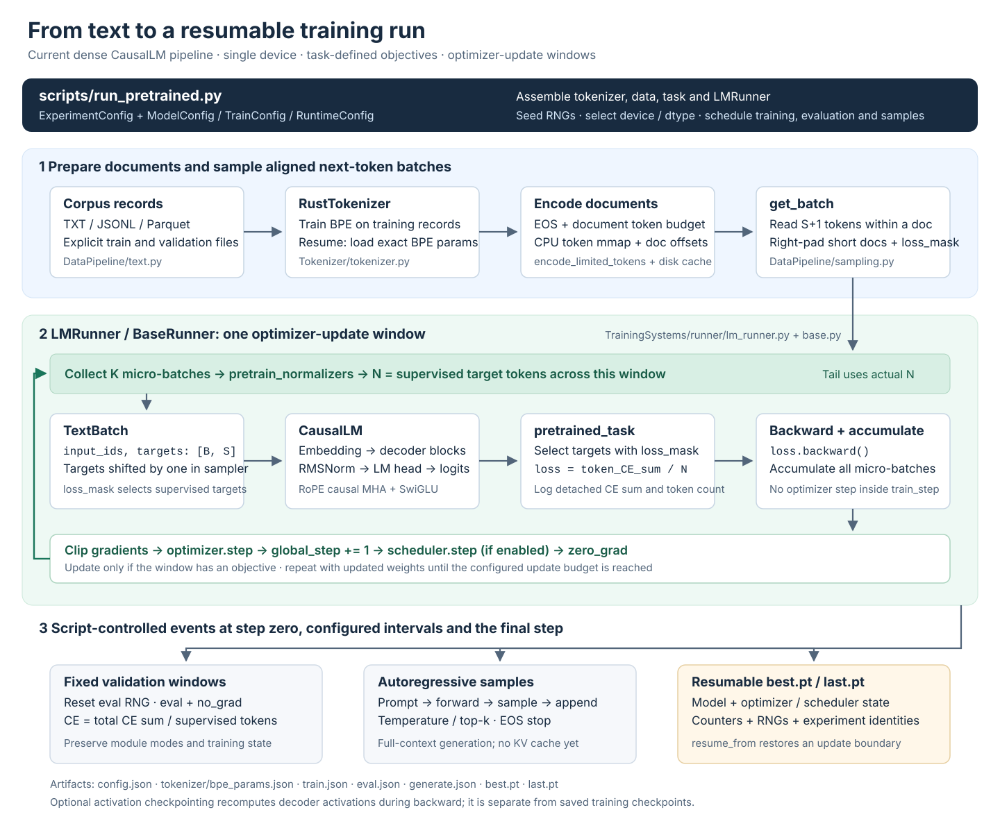

<div align="center">

# 🧠 LLM From Scratch

### **Learn the math. Build the system. Own the pipeline.**

**An engineering-oriented journey from tokenizer internals to a modular language-model stack.**  
Inspired by Stanford **CS336: Language Modeling from Scratch** — organized for learning, experimentation, and end-to-end research workflows.

<p>
  
  
  
  
</p>

**[✨ Highlights](#highlights)** · **[✅ Status](#status)** · **[🗺️ Architecture](#architecture)** · **[🚀 Quick Start](#quick-start)** · **[📍 Roadmap](#roadmap)** · **[🇨🇳 简体中文](README.zh-CN.md)**

</div>

---

> **🚧 Active development**

<a id="highlights"></a>

## 🌟 Why this repository?

- 🧩 **From mathematical components to a complete system**
- 🧠 **Understand before optimizing**
- 🔬 **Designed for research experiments**

**For whom?** Students, engineers, and researchers building an understandable language-model stack.

<a id="status"></a>

## ✅ Current capabilities

| Module | ✅ Implemented | 🛠️ Next steps | 🔭 Further extensions |
|:--|:--|:--|:--|
| 📝 **Tokenizer** | Character / UTF-8 byte tokenizers; Python byte-level BPE; Rust-backed BPE training and encoding; exact vocabulary / merge / special-token save and reload; parameter fingerprints | Broader cross-backend and corpus coverage | Alternative tokenization algorithms |
| 📦 **DataPipeline** | TXT / JSONL / Parquet readers; document-aware S+1 sampling; aligned TextBatch inputs / targets; short-document right padding and supervision loss_mask | General packing and explicit visibility contracts | Data sharding, preference and multimodal batches |
| 🧠 **ModernLM** | Linear, Embedding, RMSNorm, SiLU, RoPE; reference causal MHA, SwiGLU, pre-RMSNorm decoder, TransformerModel / CausalLM; external initialization, stable per-token CE, structured outputs, activation checkpointing; temperature / top-k / greedy / EOS generation | KV cache, prefill / decode, GQA / MQA | Configurable component variants, hybrid models, MoE, multimodal composition |
| 🎯 **Tasks** | Next-token pretraining; mean / sum objectives; supervision selection; accumulation-window token counts; detached CE numerators / denominators | SFT data and task integration; auxiliary objective composition | Preference optimization and online RL objectives |
| ⚙️ **TrainingSystems / runner** | BaseRunner / LMRunner; shared configured optimizers / schedulers; gradient accumulation, partial windows, clipping, fit / eval; model / optimizer / scheduler / counter / RNG save and restore | Mixed precision and runtime optimization | Distributed execution and multiple model roles |
| 🚀 **scripts** | Python BPE training / export; run_pretrained.py trains or restores Rust BPE, encodes documents with EOS, uses temporary disk-backed CPU token streams, and records training / fixed validation / generation / checkpoints | Refresh pretraining regression checks for the current data and configuration interfaces | run_sft / run_dpo and other task entries |

<a id="architecture"></a>

## 🗺️ Architecture



### 📁 Repository map

```text
LLM-From-Scratch/
├── README.md
├── README.zh-CN.md
├── requirements.txt
├── assets/
│   ├── training-pipeline.svg
│   └── training-pipeline.png      # Raster preview of the same diagram
├── DataPipeline/
│   ├── batch.py                  # TextBatch
│   ├── sampling.py               # Continuous / document-aware S+1 windows
│   └── text.py                   # TXT / JSONL / Parquet readers
├── ModernLM/
│   ├── layers/                   # Linear / Embedding / RMSNorm / SiLU
│   ├── position/rope.py
│   ├── attention/
│   │   ├── backends/reference.py # Reference SDPA
│   │   └── self_attention.py     # Causal MHA and RoPE
│   ├── feedforward/dense.py      # SwiGLU
│   ├── blocks/decoder.py         # Pre-RMSNorm decoder
│   ├── objectives/ce.py          # Per-token cross-entropy
│   ├── generation/sampling.py    # Full-context generation, without KV cache
│   ├── config.py                 # ModelConfig / RuntimeConfig / TrainConfig
│   ├── initialization.py
│   ├── model.py                  # TransformerModel / CausalLM
│   └── outputs.py
├── Tasks/
│   └── pretrained.py             # Objective and window normalizers
├── Tokenizer/
│   ├── base.py
│   ├── bpe_utils.py
│   ├── common.py                 # Parameter save / reload / fingerprints
│   └── tokenizer.py              # Character / Byte / Python BPE / Rust BPE
├── TrainingSystems/
│   └── runner/                   # Only this TrainingSystems package is released
│       ├── base.py
│       ├── lm_runner.py
│       └── checkpoint.py
└── scripts/
    ├── common.py                 # ExperimentConfig and document encoding
    ├── run_bpe_train.py
    ├── run_pretrained.py
    ├── test_pretrained.py
    ├── test_runner.py
    └── test_tokenizer.py
```

<a id="quick-start"></a>

## 🚀 Quick Start

### 1. Install dependencies

```powershell
conda create -n llm-scratch python=3.12 -y
conda activate llm-scratch
python -m pip install -r requirements.txt
```

### 2. Example configuration

```python
if __name__ == "__main__":
    data_dir = PROJECT_ROOT / "data" / "quickstart"
    output_dir = PROJECT_ROOT / "outputs" / "quickstart"
    data_dir.mkdir(parents=True, exist_ok=True)
    train_text = "".join(
        f"= Training article {i} =\n"
        "The fox reads a small book. The book is blue. "
        "A language model predicts the next token.\n"
        for i in range(24)
    )
    val_text = "".join(
        f"= Validation article {i} =\n"
        "A blue book is on the table. A small fox reads a book "
        "and predicts the next token.\n"
        for i in range(8)
    )
    (data_dir / "train.txt").write_text(train_text, encoding="utf-8")
    (data_dir / "val.txt").write_text(val_text, encoding="utf-8")

    experiment = ExperimentConfig(
        model_cfg=ModelConfig(
            vocab_size=512, hidden_size=64, num_layers=2,
            num_attention_heads=4, num_kv_heads=4,
            head_dim=16, value_head_dim=16,
            intermediate_size=128, max_seq_len=64,
        ),
        train_cfg=TrainConfig(
            optimizer={"name": "adamw", "params": {"lr": 1e-3}},
            batch_size=2, gradient_accumulation_steps=2,
        ),
        runtime_cfg=RuntimeConfig(
            device="cpu", dtype=torch.float32, grad_max_norm=1.0,
        ),
        tokenizer_path=output_dir / "tokenizer" / "bpe_params.json",
        train_paths=[data_dir / "train.txt"],
        val_paths=[data_dir / "val.txt"],
        output_dir=output_dir,
        max_train_tokens=None, max_val_tokens=None,
        context_length=64, num_updates=20,
        eval_interval=5, eval_batches=2, generate_interval=10,
        generate_prompts=("A small fox",), max_new_tokens=16,
    )
    run_pretrained(experiment)
```

### 3. Run run_pretrained.py

```powershell
python scripts/run_pretrained.py
```

### 4. Resume training

```python
experiment = replace(
    experiment,
    resume_from=Path(experiment.output_dir) / "last.pt",
    num_updates=2,
)
run_pretrained(experiment)
```

<a id="roadmap"></a>

## 📍 Roadmap: from foundations to a research toolbox

| Milestone | Goal | Progress |
|:--|:--|:--|
| **v0.1 · Foundations** | Tokenizer, core layers, RoPE, reference MHA, SwiGLU, decoder, CausalLM, initialization, stable CE | ✅ Core components implemented |
| **v0.2 · Dense-LM training loop** | Document-aware data, train / validation, resumable checkpoints, basic generation, real-corpus experiments | ✅ End-to-end path implemented |
| **v0.3 · Inference internals** | KV cache, prefill / decode, GQA / MQA, and cached-generation checks | 🧭 Planned; temperature / top-k / greedy / EOS sampling already implemented |
| **v0.4 · Architecture laboratory** | Explicit norm / FFN / attention / block selection and controlled ablations | 🧭 Planned; current constructors select one dense architecture |
| **v0.5 · Sparse and hybrid models** | Single-device MoE routing / experts / auxiliary losses, then hybrid sequence experiments | 🧭 Planned |
| **v0.6 · Runtime extensions** | AMP and performance work, then distributed execution as needed | 🧭 Planned; accumulation, clipping, and activation checkpointing already implemented |
| **v0.7+ · Research toolbox** | SFT / preference optimization → multimodal modeling → online RL; reusable experiment configurations and evaluation workflows | 🔭 Long term |

## 🤝 Contributing & learning together

GitHub Issues and Pull Requests are welcome for technical discussions, bug reports, tests, and documentation.

## 📚 Acknowledgments & references

- **Stanford CS336 — Language Modeling from Scratch:** [official course](https://cs336.stanford.edu/) · [course repositories](https://github.com/stanford-cs336)
- **PyTorch:** [documentation](https://pytorch.org/docs/stable/index.html)
- **einops:** [documentation](https://einops.rocks/)
- **Hugging Face Tokenizers:** [documentation](https://huggingface.co/docs/tokenizers/index)
- **WikiText:** [dataset and data card](https://huggingface.co/datasets/Salesforce/wikitext)

This is an **independent learning and engineering project inspired by CS336**.

---

<div align="center">

**From the first byte to the next token — one understandable component at a time.** 🚀

*Learn deeply · Build carefully · Verify everything*

</div>
